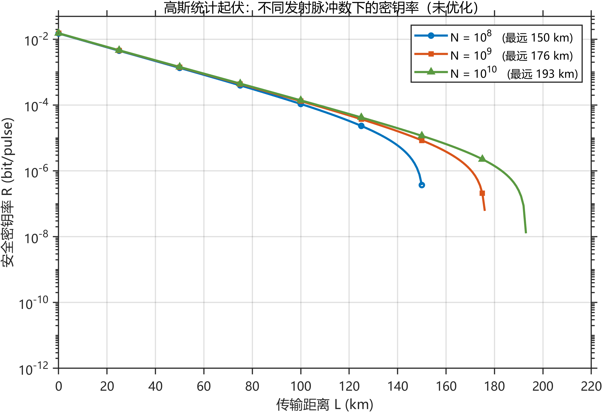
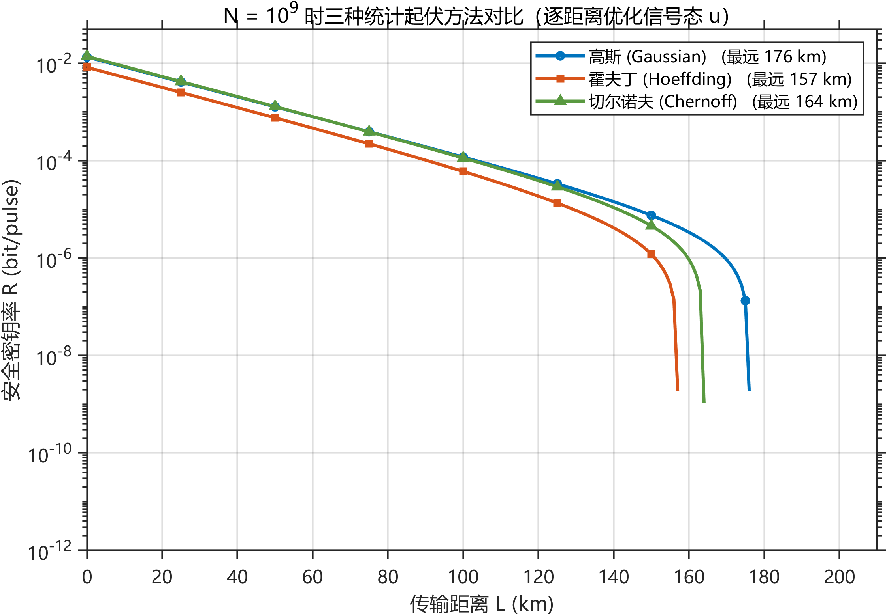
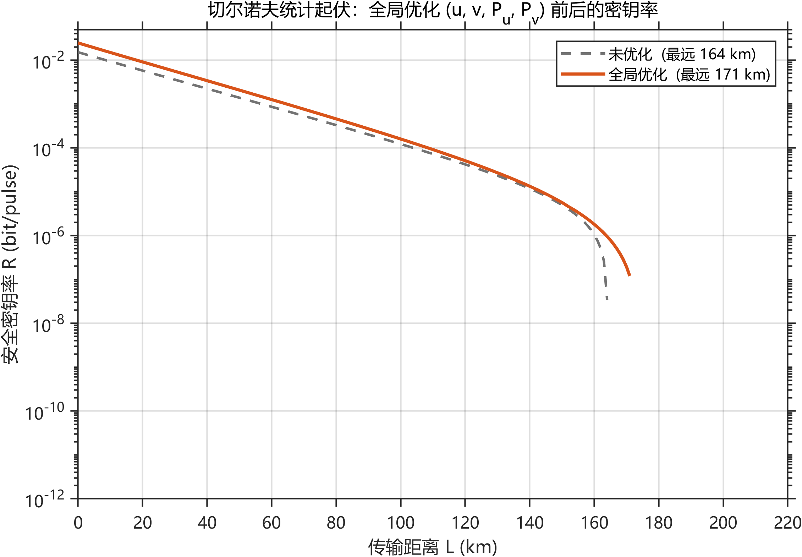

# qkd_decoy_sim

[English](#english) | 中文

**基于弱相干光源（WCS）的三强度诱骗态 BB84 密钥率仿真。**
统一实现高斯、霍夫丁、切尔诺夫三种有限长统计起伏方法，并支持对
信号态光强 $u$、诱骗态光强 $v$ 与选择概率的联合全局优化。

纯 MATLAB 实现（R2020a 起），不依赖任何工具箱，含代码化 GUI。

[](https://github.com/MungBean2435/qkd_decoy_sim-NJUPT/actions/workflows/ci.yml)
[](LICENSE)

---

## 一、这个程序算什么

给定一组系统参数（光强、概率、损耗、探测效率、暗计数、本底误码），
逐距离点计算**安全密钥率** $R(L)$，并画出 $R$ – $L$ 曲线。物理链路对应指导书：

| 环节 | 公式 | 代码 |
| --- | --- | --- |
| 信道穿透率 | $\eta = \eta_d\,10^{-\alpha L/10}$ | [+qkd/gain.m](+qkd/gain.m) |
| 增益 | $Q_l = Y_0 + 1 - e^{-\eta l}$ | [+qkd/gain.m](+qkd/gain.m) |
| 误码率 | $E_l = (e_0Y_0 + e_d\eta_l)/Q_l$ | [+qkd/gain.m](+qkd/gain.m) |
| 有限长置信区间 | 高斯 / 霍夫丁 / 切尔诺夫三种偏差函数 | [+qkd/fluct.m](+qkd/fluct.m) |
| 诱骗态估计 | $Y_1^{Z,L}$（式 3.28）、 $e_1^{X,U}$（式 3.29） | [+qkd/estimate.m](+qkd/estimate.m) |
| 密钥率 | 式 (3.30) | [+qkd/keyRateAt.m](+qkd/keyRateAt.m) |

三种起伏方法**只差「观测值 → 置信区间」一步**，因此共用同一条估计链：

- **高斯**： $\Delta = \gamma\sqrt{Q/N}$，其中 $\gamma = \sqrt{2}\,\mathrm{erfcinv}(\varepsilon)$（式 3.24 / 3.25）
- **霍夫丁**： $|\Delta Q| = \sqrt{n_W\ln(1/\varepsilon)/2}\,/N$（式 3.31 / 3.33）
- **切尔诺夫**：下界 $\Delta = \sqrt{2x\ln(16/\varepsilon^4)}$，上界 $\widehat{\Delta} = \sqrt{2x\ln\varepsilon^{-1.5}}$（式 3.37）

## 二、快速开始

需要 MATLAB **R2020a 或更新**（[exportgraphics](https://www.mathworks.com/help/matlab/ref/exportgraphics.html) 要求 R2020a+）。

```matlab
% 在仓库根目录
addpath(genpath(pwd));

launch          % 打开图形界面（改参数 → 运行 → 叠加多条曲线 → 导出 PNG）
runTests        % 回归自检，全 PASS 说明计算链正常
```

批量出图并写入 `results/`：

```matlab
run_task1        % 图1：高斯起伏，N = 1e8 / 1e9 / 1e10，不优化
run_task2        % 图2：高斯 / 霍夫丁 / 切尔诺夫，N = 1e9，逐距离优化 u
run_task3        % 图3：切尔诺夫，N = 1e9，全局优化 (u, v, P_u, P_v)
verify           % 一致性核查，写 results/verify.log
exportReportData % 报告用数值表 results/report_tables.csv
```

### 中文字体

图中所有中文标注都通过 [cjkFont.m](cjkFont.m) 取字体名，按平台依次探测：
Windows 用 `Microsoft YaHei`，macOS 用 `PingFang SC`，Linux 用 `Noto Sans CJK` 或 `WenQuanYi`。

探测不到任何中文字体时会退回 `Helvetica`。**这一情形下代码仍能正常跑完、不会抛异常，
但图里的中文会显示成方框**，属于渲染问题而不是程序错误。Linux（包括 CI 的 `ubuntu-latest`）
默认通常不带中文字体，需要先装一次：

```bash
sudo apt-get install -y fonts-noto-cjk
```

所以 CI 里的出图步骤只验证「流程能跑通」，产物不作为报告插图——正式插图请在装有中文字体的
Windows 或 macOS 上跑 `run_task1/2/3`。

## 三、当前结果

三种方法在 $N = 10^9$、 $\varepsilon = 10^{-7}$、题目给定未优化参数下的关键数值：

| 方法 | $R(0)$ | $R(100\,\mathrm{km})$ | 最远成码距离 |
| --- | --- | --- | --- |
| 高斯 Gaussian | $1.522\times10^{-2}$ | $1.314\times10^{-4}$ | 176 km |
| 霍夫丁 Hoeffding | $1.475\times10^{-2}$ | $9.088\times10^{-5}$ | 150 km |
| 切尔诺夫 Chernoff | $1.514\times10^{-2}$ | $1.220\times10^{-4}$ | 164 km |







> 全部图像由 `run_task1/2/3` 生成，对应的 CSV 数值表在 [results/](results/)。
> `.fig` 为二进制中间文件，不纳入版本控制。

**结论要点**

1. 发射脉冲数 $N$ 从 $10^8$ 增至 $10^{10}$，有限长惩罚迅速减小，最远距离由 150 km 提升到 193 km；
   曲线在中近距离几乎重合，差异集中出现在「密钥率即将归零」的远端。
2. 固定 $N = 10^9$ 并逐距离优化 $u$ 时，高斯界最宽松（176 km），霍夫丁界最保守（150 km），
   切尔诺夫居中（164 km）。
3. 切尔诺夫下全局优化 $(u,v,P_u,P_v)$ 把最远距离由 164 km 推到 172 km，中近距离密钥率提升 30%–50%；
   最优参数随距离演化：近距离偏大 $u$、小 $v$，远距离需要抬高 $v$ 与 $P_v$ 才能估准单光子参数。

## 四、目录结构

```
qkd_decoy_sim/
├── +qkd/                 # 计算内核（唯一含物理公式的地方）
│   ├── params.m          #   题目给定参数 + 派生量 Y0、P0
│   ├── gain.m            #   穿透率、增益 Q、误码率 E
│   ├── fluct.m           #   三种起伏方法的置信区间工厂
│   ├── estimate.m        #   诱骗态估计 Y1L、e1U
│   ├── keyRateAt.m       #   单点密钥率 (3.30)
│   └── runCase.m         #   统一入口：扫描距离 / 优化 u / 全局优化
├── QKDApp.m              # GUI（纯代码 uifigure，无 .mlapp）
├── launch.m              # 一键启动 GUI
├── run_task1/2/3.m       # 三个任务的出图脚本（只调内核 + 画图）
├── newFig.m saveResult.m # 出图与存盘工具
├── cjkFont.m             # 跨平台中文字体探测
├── runTests.m            # 回归自检（CI 调用）
├── selfTest.m verify.m smokeGUI.m exportReportData.m
├── results/              # 生成的 PNG + CSV（.fig 已忽略）
└── .github/workflows/    # CI
```

**分层约定**：`+qkd/` 不含任何绘图代码；`QKDApp.m` 与 `run_task*.m` 不含任何物理公式。
新增方法 = 在 `fluct.m` 加一个分支，其余代码不动。

## 五、协作

本仓库由 2 人共同开发。完整规范见 [CONTRIBUTING.md](CONTRIBUTING.md)，这里只列最常用的部分。

### 首次配置

```bash
git clone https://github.com/MungBean2435/qkd_decoy_sim-NJUPT.git
cd qkd_decoy_sim
git config core.autocrlf input      # 建议，避免换行符制造整文件 diff
```

MATLAB 里先跑一遍自检，全 PASS 再动手：

```matlab
addpath(genpath(pwd));
runTests
```

### 提交流程

```bash
git switch main && git pull        # 先同步别人的改动
git switch -c feat/your-topic      # 新分支，前缀用 feat/ fix/ docs/ test/
# ……改代码……
```

```matlab
runTests                           # 绿了再提交
```

```bash
git add -A
git commit -m "feat(fluct): 增加 xxx"
git push -u origin feat/your-topic
```

推完在网页点 **Compare & pull request**，另一人看过后再合并到 `main`。

### 四条约定

| 约定 | 原因 |
| --- | --- |
| 不直接推 `main`，一律走 PR | 建议在 Settings → Rules 给 `main` 加规则，要求 PR + 1 人 approve，开启后强制生效 |
| 改动物理模型必须同步 `runTests.m` 里的金标准 | 否则 CI 变红时分不清是「改对了」还是「改错了」 |
| 不手工合并 `results/*.png`、`*.csv` | 生成物无法逐行合并；冲突时重跑 `run_task1/2/3` 覆盖即可 |
| 提交信息带前缀 `feat` / `fix` / `docs` / `test` | 便于按类型回溯改动 |

### 关于 CI

每次 push 和 PR 都会自动跑 `runTests`。变红通常意味着数值偏离了金标准，或代码在 Linux 上跑不通。
先在本地复现再改，不要把红的 PR 合进 `main`。

### 遇到冲突

`.m` 文件已由 `.gitattributes` 统一为 LF 换行。若仍出现整文件 diff，检查本机配置：

```bash
git config --get core.autocrlf     # 建议 input 或 false
```

## 六、说明

- 本项目为课程设计仿真程序，用于教学与研究复现，**不构成密钥分发系统的安全性证明**。
- 代码按原公式实现，未做侧信道、探测器致盲等攻击建模。

## 七、许可

[MIT](LICENSE)

---

## English

Simulation of the secure key rate for a three-intensity decoy-state BB84 protocol
with weak coherent sources. Implements Gaussian, Hoeffding and Chernoff
finite-key fluctuation bounds behind a single estimation pipeline, plus a
joint global optimiser over $(u, v, P_u, P_v)$.

Requires MATLAB R2020a or later; no toolboxes. Start with:

```matlab
addpath(genpath(pwd));
launch      % GUI
runTests    % regression checks
run_task1   % figures + CSV into results/
```

Chinese labels are drawn with a font picked by [cjkFont.m](cjkFont.m)
(`Microsoft YaHei` / `PingFang SC` / `Noto Sans CJK`). If no CJK font is
installed the code still runs to completion, but Chinese text renders as
boxes; on Linux install `fonts-noto-cjk` first.

Contributions welcome — see [CONTRIBUTING.md](CONTRIBUTING.md). Licensed under MIT.
